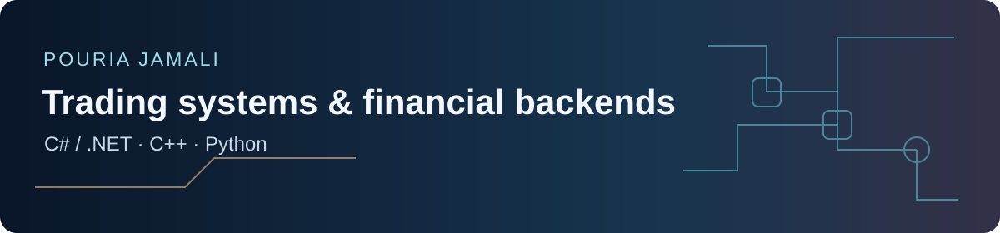

# Pouria Jamali

**Senior C#/.NET Engineer | Trading Systems & Financial Backend**

I build futures execution and order-risk systems, and modernise payment backends. My work includes TT execution in C#, C++ HFT connectivity development and payment back-office architecture.

[Portfolio](https://pouriajamali.site/) · [60-second review](https://pouriajamali.site/work/engineering-evidence/#quick-review) · [Resumes & Contact](https://pouriajamali.site/resumes/) · [LinkedIn](https://www.linkedin.com/in/pouria-jamali-a6a04138/)

## Try the operator panel

Reserve an order, retry the same request, then test the exposure limit. The browser demo uses synthetic data and needs no installation or account.

[Open the interactive demo](https://pouriajamali.site/demo/operator-panel/) · [Read the transaction design](https://github.com/pouriajamali/trading-execution-lab/blob/v0.4.0/docs/decisions/0002-transactional-control-plane.md)

## Public engineering work

### C# — Trading Execution Lab

Order-state transitions, reserved exposure and retry-safe receipts. Inspect how SQLite commits state, the request receipt and an audit outbox record together; the tests cover retries, rollback and repeated delivery.

[Source & tests](https://github.com/pouriajamali/trading-execution-lab) · [Design decisions](https://github.com/pouriajamali/trading-execution-lab/tree/main/docs/decisions) · [Source release](https://github.com/pouriajamali/trading-execution-lab/releases/tag/v0.4.0)

### C++20 / Python — Book Replay Lab

Deterministic replay and reference checks, plus a fixed-capacity C++ depth-update experiment. The measurement notes include raw observations, allocation scope and clock-resolution limits.

[Source & tests](https://github.com/pouriajamali/book-replay-lab) · [Depth experiment](https://github.com/pouriajamali/book-replay-lab/blob/main/FLAT_DEPTH.md) · [Source release](https://github.com/pouriajamali/book-replay-lab/releases/tag/v1.2.0)

### C# — Market Data Integrity Lab

Offline OHLC CSV row validation with exact integer scaling and traceable quarantine reports. The preview includes a 60-second recording and Windows/Linux x64 packages.

[Source & tests](https://github.com/pouriajamali/market-data-integrity-lab) · [Demo & downloads](https://github.com/pouriajamali/market-data-integrity-lab/releases/tag/v0.6.0-preview.1)

The labs use independent synthetic or offline fixtures. Setup, evidence, attribution and scope are documented in each repository.

## Professional experience

**Trading systems:** [Futures execution and risk controls](https://pouriajamali.site/work/tt-execution/) · [C++/Python simulation contribution](https://pouriajamali.site/work/cpp-python-simulation/)

**Financial backend:** [SEP back-office modernisation](https://pouriajamali.site/work/payments-modernisation/) · [Payment switch](https://pouriajamali.site/work/payment-switch/)

**Payment devices:** [PC–POS and device protocols](https://pouriajamali.site/work/#work-devices)
