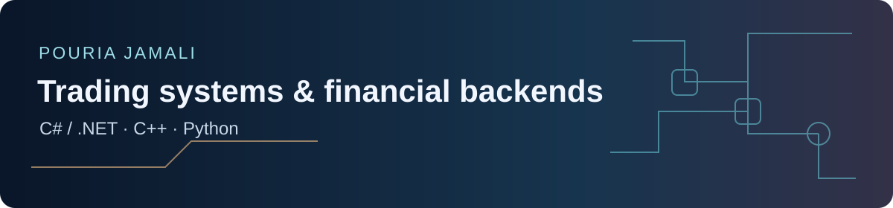
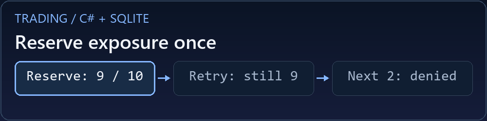
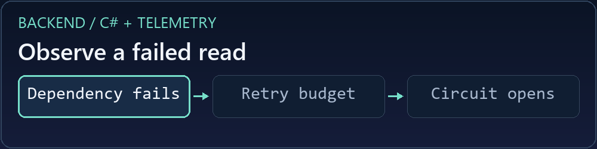
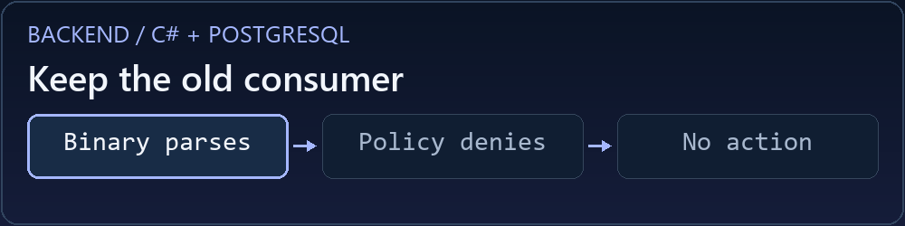
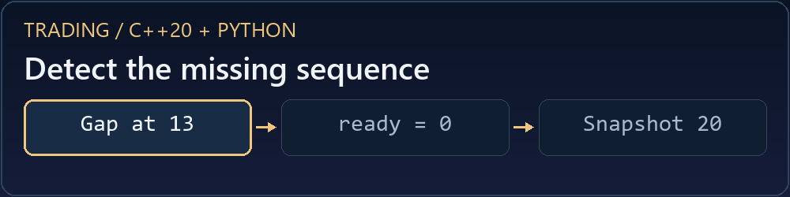

# Pouria Jamali

**Senior C#/.NET Engineer | Trading Systems & Financial Backend**

I build futures execution and order-risk systems, and modernise payment backends. My work includes TT execution in C#, C++ HFT connectivity development and payment back-office architecture.

[Portfolio](https://pouriajamali.site/) · [Resumes & Contact](https://pouriajamali.site/resumes/) · [LinkedIn](https://www.linkedin.com/in/pouria-jamali-a6a04138/)

## Choose a review path

**Trading / execution:** [Execution](https://github.com/pouriajamali/trading-execution-lab) → [FIX recovery](https://github.com/pouriajamali/fix-session-recovery-harness). Inspect retry-safe state first, then the session boundary.

**Financial backend:** [Reconciliation ledger](https://github.com/pouriajamali/financial-reconciliation-ledger) → [Contract evolution](https://github.com/pouriajamali/contract-evolution-lab). Inspect durable posting and receipts, then version compatibility.

## Four illustrated examples

Start with the decision and its test evidence below each illustration, then open the repository for the implementation. Each illustration follows a documented synthetic scenario.

### [Trading Execution Lab](https://github.com/pouriajamali/trading-execution-lab)

<a href="https://github.com/pouriajamali/trading-execution-lab"><picture><source media="(max-width: 600px) and (prefers-reduced-motion: reduce)" srcset="assets/showcase/execution-mobile.png"><source media="(max-width: 600px)" srcset="assets/showcase/execution-mobile.gif"><source media="(prefers-reduced-motion: reduce)" srcset="assets/showcase/execution.png"></picture></a>

C# application and tests; Python verification tools. Inspect the transaction that binds order state, the retry receipt and audit outbox.

[Try the browser demo](https://pouriajamali.site/demo/operator-panel/) · [Preview][execution-release] · [Decision & tests][execution-design]

### [Service Reliability Lab](https://github.com/pouriajamali/service-reliability-lab)

<a href="https://github.com/pouriajamali/service-reliability-lab"><picture><source media="(max-width: 600px) and (prefers-reduced-motion: reduce)" srcset="assets/showcase/reliability-mobile.png"><source media="(max-width: 600px)" srcset="assets/showcase/reliability-mobile.gif"><source media="(prefers-reduced-motion: reduce)" srcset="assets/showcase/reliability.png"></picture></a>

C# policy, executable checks and recorded traces. Follow bounded retries, cancellation and the single recovery probe.

[Try the browser demo](https://pouriajamali.site/demo/service-reliability/) · [Preview][reliability-release] · [Decision & tests][reliability-design]

### [Contract Evolution Lab](https://github.com/pouriajamali/contract-evolution-lab)

<a href="https://github.com/pouriajamali/contract-evolution-lab"><picture><source media="(max-width: 600px) and (prefers-reduced-motion: reduce)" srcset="assets/showcase/contracts-mobile.png"><source media="(max-width: 600px)" srcset="assets/showcase/contracts-mobile.gif"><source media="(prefers-reduced-motion: reduce)" srcset="assets/showcase/contracts.png"></picture></a>

C# producer/consumer applications; Python orchestration. Review semantic compatibility and PostgreSQL expand/backfill/contract boundaries.

[Preview][contracts-release] · [Decision & tests][contracts-design]

### [C++20 / Python Book Replay](https://github.com/pouriajamali/book-replay-lab)

<a href="https://github.com/pouriajamali/book-replay-lab"><picture><source media="(max-width: 600px) and (prefers-reduced-motion: reduce)" srcset="assets/showcase/replay-mobile.png"><source media="(max-width: 600px)" srcset="assets/showcase/replay-mobile.gif"><source media="(prefers-reduced-motion: reduce)" srcset="assets/showcase/replay.png"></picture></a>

Independent C++ and Python implementations. Inspect expected states, sequence gaps and explicit snapshot recovery.

[Preview][replay-release] · [Decision & tests][replay-design]

The diagrams illustrate behaviour; the linked source, tests and release notes carry the evidence. All fourteen projects remain in the catalogue below.

## Try the operator panel

Reserve an order, retry the same request, then inspect the exposure limit. The browser example uses synthetic data and needs no installation or account.

The project catalogue below can be reviewed directly on GitHub. Each repository keeps its code, tests, design decisions and preview downloads together.

All 14 public projects

## Trading & connectivity

| Project | What to inspect | Code / preview |
| --- | --- | --- |
| Trading Execution Lab | Retry-safe exposure reservations, SQLite receipts/outbox and a JWT operator API. | [Code](https://github.com/pouriajamali/trading-execution-lab) · [Preview][execution-release] |
| FIX Session Recovery | QuickFIX/n sequence gaps, duplicates, stored resends and controlled restart. | [Code](https://github.com/pouriajamali/fix-session-recovery-harness) · [Preview][fix-release] |
| Price-Time Matching | Two C# implementations checked against an independent Python model. | [Code](https://github.com/pouriajamali/price-time-matching-core) · [Preview][matching-release] |
| C++20 / Python Book Replay | Gap/snapshot recovery and fixed-capacity depth checked against a reference. | [Code](https://github.com/pouriajamali/book-replay-lab) · [Preview][replay-release] |
| Tail-Latency Evidence | Open-loop accounting; inspect the M1 witness boundary and documented standalone-oracle limits. | [Code](https://github.com/pouriajamali/tail-latency-evidence-bench) · [Preview][latency-release] |

## Financial backend & distributed systems

| Project | What to inspect | Code / preview |
| --- | --- | --- |
| Service Reliability | Bounded retries, cancellation, circuit recovery and ActivitySource/Meter instrumentation. | [Code](https://github.com/pouriajamali/service-reliability-lab) · [Preview][reliability-release] |
| Contract Evolution | gRPC/Protobuf semantic compatibility and PostgreSQL expand/backfill/contract. | [Code](https://github.com/pouriajamali/contract-evolution-lab) · [Preview][contracts-release] |
| Fenced Shard Ownership | etcd ownership plus PostgreSQL sink fencing and durable operation identities. | [Code](https://github.com/pouriajamali/fenced-shard-ownership-lab) · [Preview][ownership-release] |
| Financial Reconciliation | Balanced integer posts, exact retry receipts and named-snapshot reconciliation. | [Code](https://github.com/pouriajamali/financial-reconciliation-ledger) · [Preview][ledger-release] |
| Point-in-Time Reference | Effective-time history and committed knowledge revisions for late corrections. | [Code](https://github.com/pouriajamali/point-in-time-reference-lab) · [Preview][reference-release] |
| Market Data Integrity | Exact-scaled OHLC CSV validation, quarantine reports and a 60-second recording. | [Code](https://github.com/pouriajamali/market-data-integrity-lab) · [Preview][integrity-release] |
| Data Admission | Explicit coverage/freshness checks and separate owner decisions before offline admission. | [Code](https://github.com/pouriajamali/data-admission-gate) · [Preview][admission-release] |

## Developer & recovery tools

| Project | What to inspect | Code / preview |
| --- | --- | --- |
| SQLite Recovery Drill | Read-only trial copies checked against explicit application invariants. | [Code](https://github.com/pouriajamali/sqlite-recovery-drill) · [Preview][recovery-release] |
| .NET Release Doctor | Static runtime/RID/entry metadata and file-inventory checks without running the target. | [Code](https://github.com/pouriajamali/dotnet-release-doctor) · [Preview][doctor-release] |

## Professional experience

**Trading systems:** [Futures execution and risk controls](https://pouriajamali.site/work/tt-execution/) · [C++/Python simulation contribution](https://pouriajamali.site/work/cpp-python-simulation/)

**Financial backend:** [SEP back-office modernisation](https://pouriajamali.site/work/payments-modernisation/) · [Payment switch](https://pouriajamali.site/work/payment-switch/)

**Payment devices:** [PC–POS and device protocols](https://pouriajamali.site/work/#work-devices)

The public labs are independent synthetic/offline samples. Runtime requirements, attribution and the scope of each result are documented with the implementation. They are separate from employer systems.

<!-- evidence-release-links:begin -->
[execution-release]: https://github.com/pouriajamali/trading-execution-lab/releases/tag/v0.6.0-preview.1
[execution-case]: https://github.com/pouriajamali/trading-execution-lab/blob/v0.6.0-preview.1/docs/CASE-STUDY.md
[execution-design]: https://github.com/pouriajamali/trading-execution-lab/blob/v0.6.0-preview.1/docs/decisions/0002-transactional-control-plane.md
[reliability-release]: https://github.com/pouriajamali/service-reliability-lab/releases/tag/v0.1.4-preview.1
[reliability-case]: https://github.com/pouriajamali/service-reliability-lab/blob/v0.1.4-preview.1/README.md
[reliability-design]: https://github.com/pouriajamali/service-reliability-lab/blob/v0.1.4-preview.1/docs/DESIGN.md
[integrity-release]: https://github.com/pouriajamali/market-data-integrity-lab/releases/tag/v0.6.0-preview.1
[integrity-case]: https://github.com/pouriajamali/market-data-integrity-lab/blob/v0.6.0-preview.1/docs/CASE-STUDY.md
[integrity-design]: https://github.com/pouriajamali/market-data-integrity-lab/blob/v0.6.0-preview.1/README.md
[replay-release]: https://github.com/pouriajamali/book-replay-lab/releases/tag/v1.2.1-preview.1
[replay-case]: https://github.com/pouriajamali/book-replay-lab/blob/v1.2.1-preview.1/README.md
[replay-design]: https://github.com/pouriajamali/book-replay-lab/blob/v1.2.1-preview.1/FLAT_DEPTH.md
[contracts-release]: https://github.com/pouriajamali/contract-evolution-lab/releases/tag/v0.1.0-preview.2
[contracts-case]: https://github.com/pouriajamali/contract-evolution-lab/blob/v0.1.0-preview.2/README.md
[contracts-design]: https://github.com/pouriajamali/contract-evolution-lab/blob/v0.1.0-preview.2/docs/ADR.md
[ownership-release]: https://github.com/pouriajamali/fenced-shard-ownership-lab/releases/tag/v0.1.0-preview.8
[ownership-case]: https://github.com/pouriajamali/fenced-shard-ownership-lab/blob/v0.1.0-preview.8/README.md
[ownership-design]: https://github.com/pouriajamali/fenced-shard-ownership-lab/blob/v0.1.0-preview.8/docs/ADR-001.md
[matching-release]: https://github.com/pouriajamali/price-time-matching-core/releases/tag/v0.1.0-preview.2
[matching-case]: https://github.com/pouriajamali/price-time-matching-core/blob/v0.1.0-preview.2/README.md
[matching-design]: https://github.com/pouriajamali/price-time-matching-core/blob/v0.1.0-preview.2/docs/ADR.md
[reference-release]: https://github.com/pouriajamali/point-in-time-reference-lab/releases/tag/v0.1.0-preview.4
[reference-case]: https://github.com/pouriajamali/point-in-time-reference-lab/blob/v0.1.0-preview.4/README.md
[reference-design]: https://github.com/pouriajamali/point-in-time-reference-lab/blob/v0.1.0-preview.4/docs/ADR.md
[fix-release]: https://github.com/pouriajamali/fix-session-recovery-harness/releases/tag/v0.1.0-preview.6
[fix-case]: https://github.com/pouriajamali/fix-session-recovery-harness/blob/v0.1.0-preview.6/README.md
[fix-design]: https://github.com/pouriajamali/fix-session-recovery-harness/blob/v0.1.0-preview.6/docs/CASE-STUDY.md
[ledger-release]: https://github.com/pouriajamali/financial-reconciliation-ledger/releases/tag/v0.1.0-preview.3
[ledger-case]: https://github.com/pouriajamali/financial-reconciliation-ledger/blob/v0.1.0-preview.3/README.md
[ledger-design]: https://github.com/pouriajamali/financial-reconciliation-ledger/blob/v0.1.0-preview.3/docs/CASE-STUDY.md
[latency-release]: https://github.com/pouriajamali/tail-latency-evidence-bench/releases/tag/v0.1.0-preview.2
[latency-case]: https://github.com/pouriajamali/tail-latency-evidence-bench/blob/v0.1.0-preview.2/README.md
[latency-design]: https://github.com/pouriajamali/tail-latency-evidence-bench/blob/v0.1.0-preview.2/docs/ADR.md
[recovery-release]: https://github.com/pouriajamali/sqlite-recovery-drill/releases/tag/v0.1.0-preview.2
[recovery-case]: https://github.com/pouriajamali/sqlite-recovery-drill/blob/v0.1.0-preview.2/README.md
[recovery-design]: https://github.com/pouriajamali/sqlite-recovery-drill/blob/v0.1.0-preview.2/docs/CASE-STUDY.md
[doctor-release]: https://github.com/pouriajamali/dotnet-release-doctor/releases/tag/v0.1.0-preview.2
[doctor-case]: https://github.com/pouriajamali/dotnet-release-doctor/blob/v0.1.0-preview.2/README.md
[doctor-design]: https://github.com/pouriajamali/dotnet-release-doctor/blob/v0.1.0-preview.2/docs/CASE-STUDY.md
[admission-release]: https://github.com/pouriajamali/data-admission-gate/releases/tag/v0.1.0-preview.3
[admission-case]: https://github.com/pouriajamali/data-admission-gate/blob/v0.1.0-preview.3/README.md
[admission-design]: https://github.com/pouriajamali/data-admission-gate/blob/v0.1.0-preview.3/docs/COMPARISON.md
<!-- evidence-release-links:end -->
